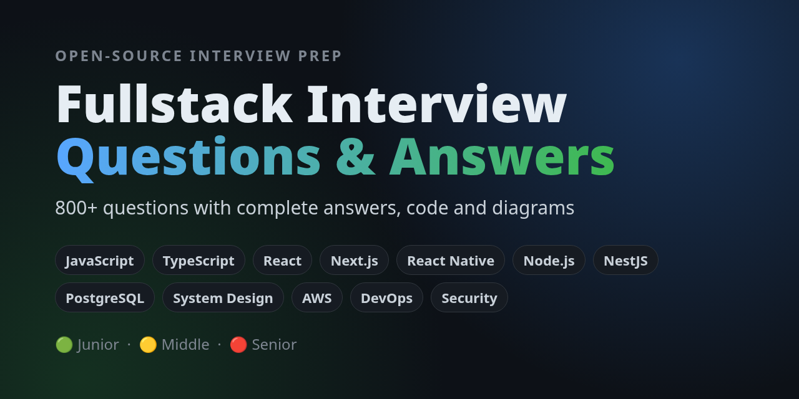

<div align="center">



# Fullstack Interview Questions & Answers

**800+ fullstack developer interview questions with complete answers, code examples and diagrams.**<br>
JavaScript · TypeScript · React · Next.js · React Native · Node.js · NestJS · SQL & PostgreSQL · API Design · System Design · Microservices · AWS · DevOps · Web Security · Testing

[](#topics)
[](#levels)
[](./LICENSE)
[](./CONTRIBUTING.md)
[](https://github.com/ivankupach/fullstack-interview-questions/stargazers)

</div>

A free, open-source collection of **fullstack, frontend and backend interview questions and answers** for software engineers preparing for technical interviews in 2026. Every question has a **complete answer**: a short answer you can say out loud first, then the deeper explanation, working code, comparison tables and diagrams.

Use it to prepare for a **JavaScript, React, Node.js or system design interview**, to brush up before a senior engineer interview loop, or as a question bank when you are the one running the interview.

<a id="levels"></a>Every question is tagged by level:

- `🟢 Junior`: fundamentals you should know cold
- `🟡 Middle`: how things work under the hood, common trade-offs
- `🔴 Senior`: production experience, architecture, failure modes

> ⭐ **If this helps you prepare, star the repo** so you can find it again before your next interview, and so other developers can find it too.

## Topics

<!-- TOPICS:START -->
| Topic | Covers | Questions | 🟢 / 🟡 / 🔴 | Diagrams |
| --- | --- | ---: | :---: | ---: |
| [Frontend](./frontend/README.md) | HTML, CSS, browser internals, web performance, accessibility | 48 | 14 / 24 / 10 | 7 |
| [JavaScript](./javascript/README.md) | Closures, event loop, prototypes, async, implement-it-yourself | 48 | 15 / 21 / 12 | 7 |
| [TypeScript](./typescript/README.md) | Generics, narrowing, conditional & mapped types, tsconfig | 43 | 10 / 19 / 14 | 4 |
| [React](./react/README.md) | Hooks, rendering, concurrent features, React 19, performance | 47 | 16 / 21 / 10 | 7 |
| [Next.js](./nextjs/README.md) | App Router, Server Components, caching, Server Actions | 42 | 10 / 18 / 14 | 8 |
| [React Native](./react-native/README.md) | New Architecture, Hermes, navigation, performance, Expo & releases | 45 | 12 / 20 / 13 | 8 |
| [Backend](./backend/README.md) | Auth, caching, queues, concurrency, rate limiting, architecture | 46 | 13 / 20 / 13 | 9 |
| [Node.js](./nodejs/README.md) | Event loop, libuv, streams, workers, production Node | 46 | 12 / 21 / 13 | 7 |
| [NestJS](./nestjs/README.md) | Modules, DI & scopes, request lifecycle, guards, testing | 47 | 12 / 22 / 13 | 8 |
| [Databases](./databases/README.md) | SQL, transactions, isolation, indexes, replication, NoSQL | 49 | 13 / 23 / 13 | 11 |
| [PostgreSQL](./postgres/README.md) | MVCC, vacuum, EXPLAIN, index types, locking, replication | 50 | 11 / 23 / 16 | 8 |
| [API Design](./api/README.md) | REST, GraphQL, gRPC, pagination, idempotency, versioning | 47 | 12 / 22 / 13 | 9 |
| [DevOps](./devops/README.md) | Docker, Kubernetes, CI/CD, IaC, observability | 49 | 13 / 21 / 15 | 10 |
| [AWS](./aws/README.md) | IAM, VPC, Lambda, S3, DynamoDB, SQS/SNS, DR & cost | 48 | 13 / 21 / 14 | 9 |
| [Microservices](./microservices/README.md) | DDD, sagas, outbox, Kafka, resilience patterns | 42 | 8 / 20 / 14 | 10 |
| [System Design](./system-design/README.md) | Concepts + case studies with architecture diagrams | 32 | 1 / 16 / 15 | 18 |
| [Web Security](./security/README.md) | OWASP, XSS, CSRF, SSRF, auth & session security | 47 | 13 / 20 / 14 | 9 |
| [Testing](./testing/README.md) | Unit/integration/e2e, RTL, Playwright, mocking, flaky tests | 41 | 11 / 19 / 11 | 6 |
| **Total** | | **817** | | |
<!-- TOPICS:END -->

## Popular questions

The questions that come up in almost every fullstack interview:

| Topic | Question |
| --- | --- |
| JavaScript | [How does the event loop work (macrotasks vs microtasks)?](./javascript/README.md#24-how-does-the-event-loop-work-macrotasks-vs-microtasks) |
| JavaScript | [What is a closure?](./javascript/README.md#10-what-is-a-closure) |
| JavaScript | [Implement `debounce` and `throttle`](./javascript/README.md#34-implement-debounce-and-throttle) |
| TypeScript | [`type` vs `interface`: what is the difference?](./typescript/README.md#1-type-vs-interface-what-is-the-difference-and-which-should-you-use) |
| React | [What is the virtual DOM and why does React use it?](./react/README.md#1-what-is-the-virtual-dom-and-why-does-react-use-it) |
| React | [How does `useEffect` work? Dependencies and cleanup](./react/README.md#11-how-does-useeffect-work-explain-dependencies-and-cleanup) |
| Next.js | [What are Server Components and Client Components?](./nextjs/README.md#9-what-are-server-components-and-client-components) |
| Node.js | [Explain the Node.js event loop and its phases](./nodejs/README.md#4-explain-the-nodejs-event-loop-and-its-phases-how-does-it-differ-from-the-browsers) |
| Backend | [Sessions vs JWT: which should you choose?](./backend/README.md#8-sessions-vs-jwt-how-do-they-compare-and-which-should-you-choose) |
| Databases | [Transaction isolation levels and their anomalies](./databases/README.md#20-what-are-transaction-isolation-levels-and-which-anomalies-does-each-allow) |
| Databases | [How does a B-tree index work?](./databases/README.md#24-what-is-a-database-index-and-how-does-a-b-tree-index-work-hash-vs-b-tree) |
| Databases | [Explain the CAP theorem and PACELC](./databases/README.md#36-explain-the-cap-theorem-and-pacelc) |
| PostgreSQL | [How does MVCC work in PostgreSQL?](./postgres/README.md#12-how-does-mvcc-work-in-postgresql-xmin-xmax-tuple-visibility) |
| API Design | [REST vs GraphQL vs gRPC vs tRPC](./api/README.md#33-rest-vs-graphql-vs-grpc-vs-trpc-how-do-you-choose) |
| API Design | [What is CORS and why does the same-origin policy exist?](./api/README.md#26-what-is-cors-and-why-does-the-same-origin-policy-exist) |
| DevOps | [Docker image vs container](./devops/README.md#7-what-is-the-difference-between-a-docker-image-and-a-container) |
| Microservices | [Implement a saga orchestrator with compensations](./microservices/README.md#23-implement-a-saga-orchestrator-with-compensations) |
| System Design | [Design a URL shortener](./system-design/README.md#20-design-a-url-shortener) |
| Web Security | [What is the OWASP Top 10 (2025 edition)?](./security/README.md#1-what-is-the-owasp-top-10-and-what-does-the-2025-edition-contain) |

## How to use this repo

- **Preparing for an interview:** read the short answer first and try to say the rest out loud before you read it. The `> Follow-up:` lines show where an interviewer usually goes next.
- **Running an interview:** pick questions by level. The follow-ups are useful for probing depth.
- **Learning:** the diagrams and code samples are meant to stand on their own, so skim them first.

## Who is this for?

- **Frontend developers** preparing for JavaScript, TypeScript, React, Next.js and React Native interviews
- **Backend developers** preparing for Node.js, NestJS, SQL, PostgreSQL, API design and microservices interviews
- **Fullstack engineers** who need both, plus system design, AWS and DevOps
- **Senior engineers** preparing for system design and architecture rounds
- **Hiring managers and interviewers** who want a leveled question bank with reference answers

## Diagrams

Diagrams are written in [Mermaid](https://mermaid.js.org/) (`<topic>/diagrams/*.mmd`) and rendered to PNG with [mermaid-cli](https://github.com/mermaid-js/mermaid-cli):

```bash
npm install
npm run diagrams    # render new or changed diagrams
npm run readme      # refresh the topics table above
```

## Contributing

Found a mistake or have a better answer? PRs are welcome. See [CONTRIBUTING.md](./CONTRIBUTING.md) for the question format.

## License

[MIT](./LICENSE)
